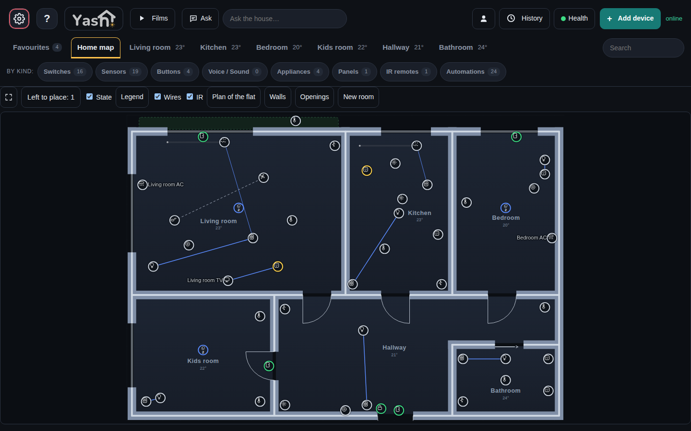

# Yashome demo

The public demo of [Yashome](https://github.com/freidkin-michael/yashome): a fictional flat of six rooms with simulated
devices, run by the same engine as a real house. One guest is in control at a time, the next ones wait in line,
and the flat goes back to its start after each turn.

The demo is a plug-in of the engine. The plug-in and its own documentation: [demo/README.md](demo/README.md).

## This repository

- `ENGINE`: the engine tag (or commit) the demo runs on. Deploys and tests use exactly that.
- `demo/`: the plug-in (sign-in and turns, route lists, limits, the simulator, the seed house, the guest's page,
  the deploy files in `demo/setup/`).
- `tests/`: the demo's tests.

## Tests

    make test ENGINE=<engine checkout> [PYTHON=<python with the engine's requirements>]
    sh run_tests.sh <engine checkout> [pytest args]       # the same

The engine at the `ENGINE` pin is unpacked into a temporary tree, `demo/` goes to `plugins/tools/demo` and
`tests/test_demo*.py` to `tests/plugins/`, then pytest runs there. The engine checkout must have the pinned tag.

## Deploy

    demo/setup/export.sh <engine checkout> <demo checkout> <run dir>

It writes `<run dir>/app`: the engine at the pin (without tests, docs, examples, the host helper and the plug-ins
the demo keeps off) plus this repository's `demo/` as `plugins-extra/demo`. When a demo is running, its containers
are created again on the new code. One deploy at a time. The steps on the demo host: [demo/README.md](demo/README.md#running-it).

The engine runs the demo in restricted mode (`YASHOME_RESTRICTED=1`): only the routes that `demo/routes.py` lists
answer, everything else gets 403.
